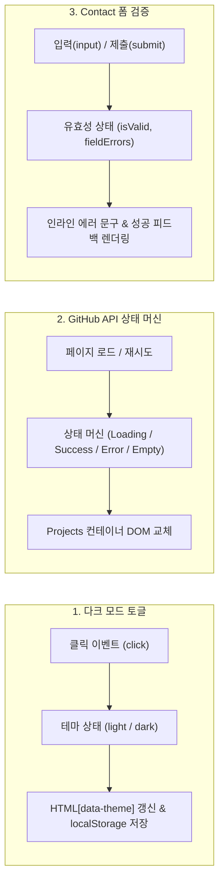

# 반응형 포트폴리오 웹사이트 (Responsive Portfolio)

> 외부 프레임워크나 라이브러리(React, Vue, jQuery, Bootstrap, Tailwind 등) 없이 **순수 HTML5, CSS3, Vanilla JavaScript(ES6+)**만으로 구현한 반응형 엔지니어 포트폴리오 웹사이트입니다.  
> 화면 외형 구현에 그치지 않고 브라우저의 기본 동작 원리인 **"사용자 이벤트(Event) → 상태 변경(State) → DOM 렌더링(Rendering)"** 흐름과 비동기 데이터 통신 및 4가지 UI 상태 머신을 체계적으로 구현했습니다.

---

## 1. 배포 및 미리보기

- **배포 URL**: [GitHub Pages 바로가기](https://vact19.github.io/portfolio/) *(저장소 설정 후 활성화)*
- **GitHub 저장소**: `https://github.com/vact19/portfolio`

### 화면 미리보기

| 데스크톱 라이트 모드 | 데스크톱 다크 모드 | 모바일 뷰 |
| :---: | :---: | :---: |
|  |  |  |

> *(참고: 실제 배포 후 스크린샷 이미지를 `images/` 폴더에 추가하여 갱신할 수 있습니다.)*

---

## 2. 사용 기술 스택 (Tech Stack)

| 구분 | 기술 스택 | 설명 |
| :--- | :--- | :--- |
| **Markup** | HTML5 | W3C 표준 시맨틱 태그 구조화 (`<header>`, `<nav>`, `<main>`, `<section>`, `<article>`, `<footer>`) |
| **Styling** | CSS3 | CSS 커스텀 변수(`:root`), Flexbox, CSS Grid, 모바일 퍼스트 미디어 쿼리, 오라클 테크 미니멀리즘 테마 |
| **Scripting** | Vanilla JavaScript (ES6+) | DOM API, Event Listener, Fetch API (`async/await`), ES6 템플릿 리터럴 및 비구조화 할당 |
| **Storage** | Web Storage API | `localStorage` 기반 테마 상태 영속화 |
| **External Lib** | **None (0개)** | React, jQuery, CSS 라이브러리 일체 배제 (순수 웹 표준 구현) |

---

## 3. 핵심 아키텍처: 이벤트-상태-렌더링 (Event-Driven State Architecture)

React와 같은 프레임워크의 선언적 렌더링 이전에 일어나는 브라우저 저수준 DOM 조작 원리를 이해하기 위해, **3가지 이상의 독립적인 "상태 → 렌더링" 흐름**을 구축했습니다.



### 1) 테마 상태 관리 흐름 (`js/theme.js`)
- **이벤트(Event)**: 헤더 우측 테마 토글 버튼 클릭 (`click`).
- **상태(State)**: 현재 테마 문자열 (`'light'` 또는 `'dark'`).
- **화면 반영(DOM Rendering)**: `document.documentElement`의 `data-theme` 속성을 갱신하여 CSS 변수 세트를 즉시 교체하고, 아이콘(🌙 / ☀️) 및 `aria-label`을 동기화.
- **영속화(Persistence)**: `localStorage.setItem('theme', ...)`으로 브라우저 재접속/새로고침 시에도 사용자 테마 유지.

### 2) 비동기 GitHub API 4단계 상태 머신 (`js/projects.js`)
외부 API 통신 시 발생할 수 있는 모든 예외와 지연 상황을 4가지 상태로 분기하여 처리합니다:
- **로딩(Loading)**: 비동기 호출 중 CSS 로딩 스피너 및 진행 안내 문구 표시.
- **성공(Success)**: `Array.prototype.map()`과 템플릿 리터럴을 통해 최신 6개 저장소를 반응형 그리드 카드로 렌더링.
- **에러(Error)**: 시간당 60회 초과(HTTP 403 Rate Limit), 네트워크 단절, 서버 에러 발생 시 사유 안내문과 **[다시 시도]** 버튼 렌더링.
- **빈 데이터(Empty)**: 응답 배열이 비어있을 경우 직관적인 안내문 표시.

### 3) 폼 유효성 검사 및 실시간 피드백 (`js/contact.js`)
- **이벤트 가로채기**: `event.preventDefault()`로 서블릿 컨테이너의 기본 폼 전송 파이프라인(페이지 새로고침) 차단.
- **검증 규칙**:
  - 이름: 공백 제거(`trim()`) 후 필수값 검증.
  - 이메일: RFC 표준 정규표현식(`/^[^\s@]+@[^\s@]+\.[^\s@]+$/`) 포맷 검증.
  - 문의 내용: 필수값 검증.
- **실시간 피드백**: 제출(`submit`) 시점에 미입력 필드로 포커스를 자동 이동시키며, 타이핑(`input`) 시점에 실시간으로 에러를 해제.

---

## 4. 인터랙션 및 레이아웃 임계값 (Thresholds)

과제 요구사항에 따른 주요 기능별 임계값과 레이아웃 수치는 다음과 같이 표준화되어 구현되었습니다:

| 기능 | 설정 임계값 | 상세 동작 및 구현 위치 |
| :--- | :---: | :--- |
| **스크롤 탑 버튼** | `300px` | `window.scrollY > 300` 도달 시 우측 하단 플로팅 버튼 표시 (`js/main.js`) |
| **헤더 스타일 변경** | `60px` | `window.scrollY > 60` 도달 시 헤더에 `.scrolled` 클래스 부여하여 배경 불투명화 및 하단 보더 표시 (`js/main.js`) |
| **섹션 스크롤 옵저버** | `0.2` (20%) | `IntersectionObserver`의 `threshold: 0.2` 설정으로 섹션이 뷰포트에 20% 이상 진입 시 부드러운 페이드인 실행 (`js/main.js`) |
| **반응형 태블릿 분기** | `768px` | 모바일 퍼스트 기준, 768px 이상에서 햄버거 메뉴 숨김 및 상단 가로 내비게이션 노출 (`css/style.css`) |
| **반응형 데스크톱 분기** | `1024px` | 1024px 이상에서 Hero 폰트 크기 및 섹션 패딩 최적화 (`css/style.css`) |
| **Projects 카드 그리드** | `minmax(280px, 1fr)` | CSS Grid `repeat(auto-fit, minmax(280px, 1fr))`로 디바이스 폭에 따라 1열~3열 자동 리플로우 (`css/style.css`) |

---

## 5. 프로젝트 디렉터리 구조

```text
result/
├── index.html              # 시맨틱 마크업 메인 페이지 (6개 섹션)
├── README.md               # 프로젝트 아키텍처 및 설명 문서
├── .gitignore              # Git 형상관리 제외 설정 파일
├── css/
│   └── style.css           # 오라클 미니멀 디자인 시스템 & 반응형 미디어 쿼리
├── js/
│   ├── main.js             # 애플리케이션 진입점 & 공통 사용자 인터랙션
│   ├── theme.js            # 다크 모드 토글 & localStorage 영속화 모듈
│   ├── projects.js         # GitHub REST API 연동 & 4단계 UI 상태 머신 모듈
│   └── contact.js          # Contact 폼 유효성 검사 & 실시간 피드백 모듈
└── images/
    └── profile.svg         # 벡터 프로필 플레이스홀더 이미지
```

---

## 6. 제약사항 준수 검증 (Compliance Checklist)

과제 가이드라인에 정의된 모든 필수 제약사항을 철저히 준수했습니다:

- [x] **외부 라이브러리 배제**: React, Vue, jQuery, Bootstrap, Tailwind 등 전무, 순수 HTML/CSS/JS 구현.
- [x] **모던 JavaScript 문법**: `var` 사용 전면 금지 (`const`, `let`만 사용).
- [x] **이벤트 바인딩 분리**: HTML 태그 내 `onclick` 등 인라인 이벤트 핸들러 일절 배제 (`addEventListener` 사용).
- [x] **인라인 스타일 금지**: HTML 태그에 `style="..."` 속성 일절 사용하지 않고 외부 스타일시트(`css/style.css`)로 분리.
- [x] **스크립트 비차단 로드**: 모든 `<script>` 태그에 `defer` 속성을 부여하여 DOM 파싱 차단 방지.
- [x] **시맨틱 마크업**: `<div>` 남용 없이 `<header>`, `<nav>`, `<main>`, `<section>`, `<article>`, `<footer>` 계층 구조화.
- [x] **접근성(A11y)**: 모든 이미지에 유의미한 `alt` 속성 부여, 폼 `<label for="...">`와 `<input id="...">` 1:1 완벽 매핑.
- [x] **API 예외 처리**: GitHub API 403 Rate Limit 및 오류 응답에 대한 폴백 UI와 재시도 액션 완비.

---

## 7. GitHub Pages 배포 가이드

1. **저장소 푸시**:
   ```bash
   git add .
   git commit -m "docs: 배포용 README.md 작성 및 프로젝트 최종 정리"
   git branch -M main
   git remote add origin https://github.com/vact19/portfolio.git
   git push -u origin main
   ```
2. **GitHub Pages 활성화**:
   - GitHub 저장소 웹페이지 접속 → **Settings** 탭 클릭
   - 좌측 메뉴에서 **Pages** 선택
   - **Build and deployment** > **Source** 항목을 `Deploy from a branch`로 설정
   - **Branch**를 `main` 브랜치 / `/ (root)` 폴더로 지정 후 **Save** 클릭
3. **접속 확인**:
   - 1~2분 후 `https://vact19.github.io/portfolio/` 주소로 접속하여 배포 상태 확인.
