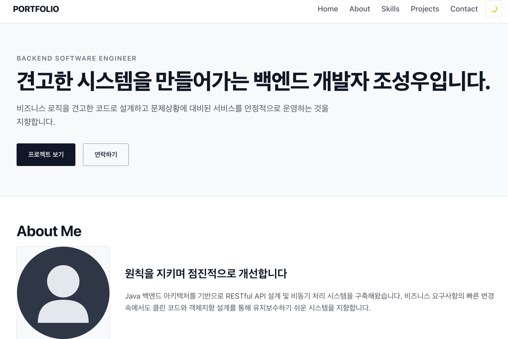

# 반응형 포트폴리오 웹사이트 (Responsive Portfolio)

> 외부 프레임워크나 라이브러리(React, Vue, jQuery, Bootstrap, Tailwind 등) 없이 **순수 HTML5, CSS3, Vanilla JavaScript(ES6+)**만으로 구현한 반응형 엔지니어 포트폴리오 웹사이트입니다.  
> 화면 외형 구현에 그치지 않고 브라우저의 기본 동작 원리인 **"사용자 이벤트(Event) → 상태 변경(State) → DOM 렌더링(Rendering)"** 흐름과 비동기 데이터 통신 및 4가지 UI 상태 머신을 체계적으로 구현했습니다.

---

## 1. 배포 및 미리보기

- **배포 URL**: [GitHub Pages 바로가기](https://codyssey-onella.github.io/B1-1-portfolio/)
- **GitHub 저장소**: `https://github.com/codyssey-onella/B1-1-portfolio`


---

## 2. 사용 기술 스택 (Tech Stack)

| 구분 | 기술 스택 | 설명 |
| :--- | :--- | :--- |
| **Markup** | HTML5 | W3C 표준 시맨틱 태그 구조화 (`<header>`, `<nav>`, `<main>`, `<section>`, `<article>`, `<footer>`) |
| **Styling** | CSS3 | CSS 커스텀 변수(`:root`), Flexbox, CSS Grid, 모바일 퍼스트 미디어 쿼리 등 |
| **Scripting** | Vanilla JavaScript (ES6+) | DOM API, Event Listener, Fetch API (`async/await`), ES6 템플릿 리터럴 및 비구조화 할당 |

---

## 3. 프로젝트 디렉터리 구조

```text
result/
├── index.html              # 시맨틱 마크업 메인 페이지 (6개 섹션)
├── README.md               # 프로젝트 아키텍처 및 설명 문서
├── .gitignore              # Git 형상관리 제외 설정 파일
├── css/
│   └── style.css           # 오라클 미니멀 디자인 시스템 & 반응형 미디어 쿼리
├── js/
│   ├── main.js             # 애플리케이션 진입점 & 공통 사용자 인터랙션
│   ├── theme.js            # 다크 모드 토글 & localStorage 영속화 모듈
│   ├── projects.js         # GitHub REST API 연동 & 4단계 UI 상태 머신 모듈
│   └── contact.js          # Contact 폼 유효성 검사 & 실시간 피드백 모듈
└── images/
    └── profile.svg         # 벡터 프로필 플레이스홀더 이미지
```

---

## 4. 제약사항 준수 검증 (Compliance Checklist)

과제 가이드라인에 정의된 모든 필수 제약사항을 철저히 준수했습니다:

- [x] **외부 라이브러리 배제**: React, Vue, jQuery, Bootstrap, Tailwind 등 전무, 순수 HTML/CSS/JS 구현.
- [x] **모던 JavaScript 문법**: `var` 사용 전면 금지 (`const`, `let`만 사용).
- [x] **이벤트 바인딩 분리**: HTML 태그 내 `onclick` 등 인라인 이벤트 핸들러 일절 배제 (`addEventListener` 사용).
- [x] **인라인 스타일 금지**: HTML 태그에 `style="..."` 속성 일절 사용하지 않고 외부 스타일시트(`css/style.css`)로 분리.
- [x] **스크립트 비차단 로드**: 모든 `<script>` 태그에 `defer` 속성을 부여하여 DOM 파싱 차단 방지.
- [x] **시맨틱 마크업**: `<div>` 남용 없이 `<header>`, `<nav>`, `<main>`, `<section>`, `<article>`, `<footer>` 계층 구조화.
- [x] **접근성(A11y)**: 모든 이미지에 유의미한 `alt` 속성 부여, 폼 `<label for="...">`와 `<input id="...">` 1:1 완벽 매핑.
- [x] **API 예외 처리**: GitHub API 403 Rate Limit 및 오류 응답에 대한 폴백 UI와 재시도 액션 완비.

---
